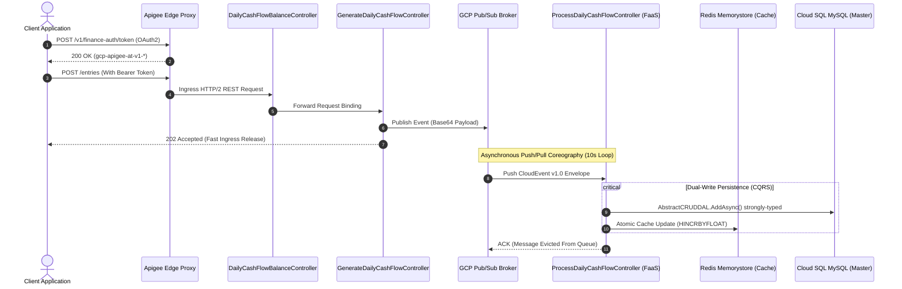
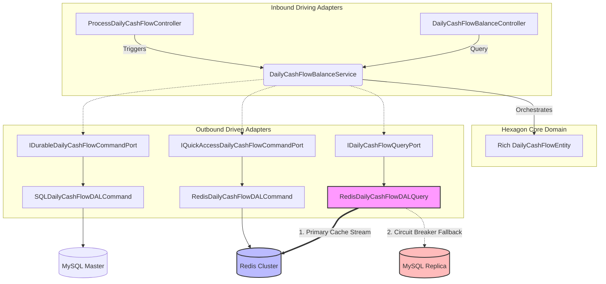
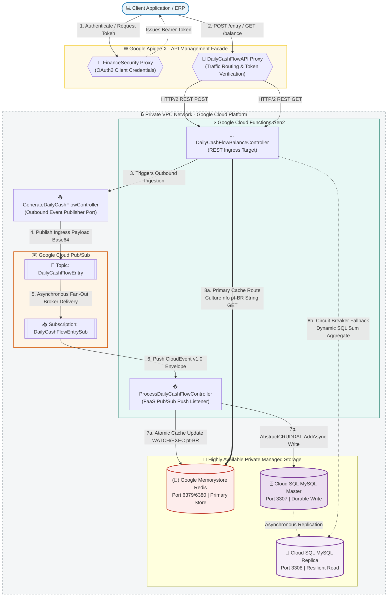
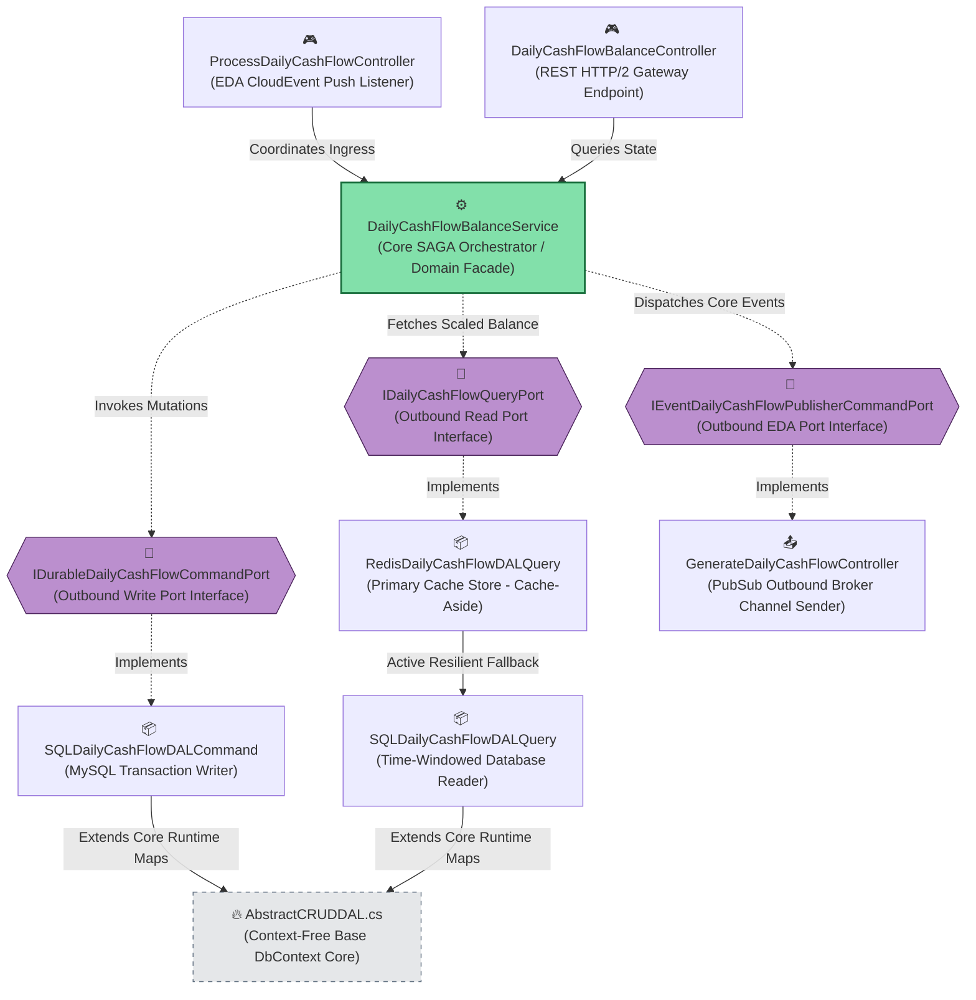
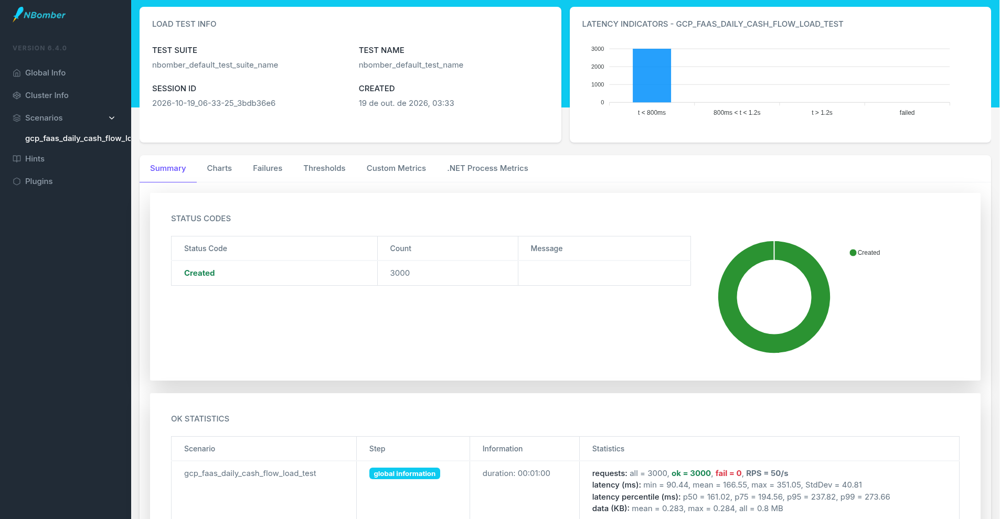

# 🏛️ Daily Cash Flow Solution

## Definition

This is it a test, for Solution Architect, which we have a challenge to control entrys of daily cash flow balance, and generate a report daily balance conform defined by document desafio-arquiteto-software-ago2024.pdf. 
I am Wellington Amaral, Solution Architect, that being participating in this challenge, to model a solution 
with the best software architecture and solution architecture patterns and practices that can be used in a real-world scenario to achieve the goal of the challenge. In terms of software architecture and solution architecture the main requirement is about the scalability and availability, supporting until 50 entries per second caming, canning have unvailibility of the service of 5% of time, reliability, keeping information of daily balance of cash flow without lose entrys, high performance, and security.


## Finance Security API 

It is a REST API to generate a OAuth2 token for authentication and validate for the DailyCashFlow API access.

## 💰 Daily Cash Flow Balance API 

REST API to receive entry values of credit or debit with high-performance, reliable, security and availiabality by POST method and obtain balance value of day that can be called of digital App(Angular for example) for control Cash Flow Balance and generate a report daily balance.

## Solution

A HTTP API Rest that receive entry values of credit or debit with high-performance, reliable, security and availiabality by POST method
and obtain balance value of day that can be called of digital App(Angular for example) for control Cash Flow Balance and generate a report daily balance.

For this API, we propose to use GCP Cloud Servless services of *APIGateway APIGee, FAAS Cloud Function Staless with .Net Core, Pub/Sub Messaging, CloudSQL SQLServer,
and Memorystore Redis* for agile to delivery, auto-scaling no need of maintain servers and operations, for easy to make DevOps.

In development we use design patterns to facility reuse, simplicity, raise of quality of software solution.


## Architecture Patterns and Practices

### 🏛️ 1. Architectural Alignment (TOGAF, CQRS, EDA & Hexagonal)

This section details the architectural governance, design patterns, and systemic principles that orchestrate the resilient and distributed financial ledger execution mesh.

#### 🗺️ TOGAF ADM Framework
Ensures strict structural alignment across all engineering abstraction layers:
* **Business Architecture (Phase B):** Guarantees durable control of daily ledger balances with zero transaction duplication or state loss.
* **Information Systems Architecture (Phase C):** Implements rigid data isolation between the volatile fast-access caching layer and the relational storage nodes.
* **Technology Architecture (Phase D):** Leverages elastic serverless FaaS compute infrastructure integrated with a secure, private corporate API Management Gateway.

#### 🎭 CQRS (Command Query Responsibility Segregation)
Segregates read and write operations to optimize performance and scale infrastructure independently:
* **Write Commands:** Handled asynchronously in the background via event-driven messaging, targeting the primary MySQL Master database cluster node.
* **Read Queries:** Pulled synchronously through a high-performance reactive caching strategy, falling back to Read Replicas to mitigate transactional lock contention on the database engine.

#### ⚡ EDA (Event-Driven Architecture)
Utilizes an asynchronous, decoupled event-driven architecture modeled around microservice choreographies:
* Inbound driving adapters process **CloudEvents v1.0** specifications wrapped inside native Google Cloud Pub/Sub push notification envelopes.
* Automatically decodes internal byte streams and base64-encoded compressed payloads without blocking the main runtime execution threads.

---

### 📐 Software Engineering & Structural Patterns

#### ⬢ Hexagonal Architecture (Ports & Adapters)
Completely isolates pure business logic and the **Core Domain** from any direct coupling with third-party frameworks, infrastructure libraries, cloud database drivers, or low-level network connection configurations.

#### 🧼 Clean Architecture
Enforces a strict separation of concerns through concentric dependency rings. All dependencies point inward, ensuring that corporate business rules remain independent of UI controllers, database engines, and runtime environmental factors.

#### 💎 SOLID Principles
Adheres to class-level object-oriented design standards to achieve high cohesion and low coupling:
* **Interface Segregation & Dependency Inversion:** Applied across all abstraction interfaces to decouple boundaries.
* **Single Responsibility:** Guarantees single-purpose execution units across the entire hexagonal mesh.

---

## 🔒 Edge Governance & API Management

#### 🛡️ API Gateway (Apigee)
Acts as the secure, external-facing boundary that manages enterprise API traffic. It enforces strict governance via **OAuth 2.0 mutual authentication, TLS/HTTPS encryption**, rate-limiting, comprehensive auditing, and real-time policy control.

#### 🌫️ Facade Pattern
Implemented at the API Management edge via Apigee, exposing clean, unified RESTful contracts to corporate clients while completely hiding underlying routing complexities, internal network subnets, and microservice topologies.

#### 📝 Design-First Strategy
Decouples contract definition from concrete code implementations by modeling services through the **OpenAPI 3.0 specification** (Swagger). The contracts are independently maintained in the repository under the `api/` directory via:
* `openapi-financesecurity.yaml`
* `openapi-dailycashflow.yaml`

---

### 🚀 Distributed Systems & Concurrency Patterns

#### 📦 Microservices & Serverless (FaaS)
Deployed as lightweight, independently executable units of compute using Google Cloud Functions (Gen2) running on top of **.NET 8 LTS**. This setup scales automatically down to zero instances, eliminating server management overhead and optimizing operational infrastructure costs.

#### 🔄 SAGA Choreography
Coordinates decentralized transactions across distributed microservice boundaries without a single point of failure:
* **`GenerateDailyCashFlowController`:** Ingests cash flow inflows/outflows instantly at the edge to guarantee rapid response times.
* **`ProcessDailyCashFlowController`:** Consumes the event to execute a resilient dual-write mechanism. It updates the MySQL database while applying an atomic mutation to the Redis state using **Optimistic Locking (WATCH/EXEC pattern)** to ensure cross-storage data consistency.

### 🕸️ Singleton Cache Pattern
The fast-access daily balance state is managed through a thread-safe, lazy-initialized connection multiplexer pool that targets a single, highly available **Google Memorystore for Redis** instance, optimized to handle intensive daily aggregations.

### 🗄️ DAL (Data Access Layer)
Encapsulates data manipulation routines within specialized infrastructure components:
* `RedisDailyCashFlowDAL` (Volatile in-memory cache)
* `SQLDailyCashFlowDAL` (Persistent relational database)
* Both extend `AbstractCRUDDAL` to inherit boilerplate data mapper behaviors while preventing leakage into the core application layer.

### 🔌 Circuit Breaker Pattern
Prevents cascading downstream network failures and guarantees high availability. If `RedisDailyCashFlowDAL` triggers persistent connection timeouts, the circuit opens immediately, gracefully routing inquiries to dynamically aggregate the ledger balance straight from the **MySQL Read Replicas via SQLDailyCashFlowDAL** until the Redis channel heals and the circuit closes.

### 🎯 DDD (Domain-Driven Design)
Tightly models the software domain around core corporate business terminology. It exposes `DailyCashFlow` as a Rich Domain Entity, leveraging the **Repository Pattern** to govern state mutations and encapsulate business invariants within the domain boundary.

### 📐 Template Method Pattern
Defines the skeleton of the algorithm pipeline inside base abstract layers, forcing a standardized execution sequence for initialization, error intercepting, and persistence routines across FaaS components and DAL implementations.

---

### ☁️ Cloud Infrastructure & Hosting Model

#### 🏢 PaaS (Platform as a Service)
Leverages fully managed cloud services—including Apigee, Google Pub/Sub, Cloud SQL, and Google Memorystore—to fast-track time-to-market, delegating OS patch management, clustering, and automated backup maintenance to the cloud provider.

#### 🌬️ Serverless Operations
Delivers a native **elastic, auto-scaling, auto-managed, and auto-healing** production environment. By utilizing the GCP Serverless suite bound to a secure VPC Access Connector (`all-traffic` egress), the architecture achieves horizontal scaling, maximum throughput, and low latency under high concurrent load spikes.


### ⚡ Integrated Strategic Pillars:

1. **Durable Query Port (MySQL):** Atomic asynchronous relational write/read operations handled by Entity Framework Core 10, completely removing manual explicit locks (`BeginTransaction`) to eliminate thread contention under heavy concurrent workloads.

2. **QuickAccess Cache Port (Redis):** Consolidated real-time balance tracking utilizing an *Optimistic Locking* pattern (`WATCH/EXECUTE`) backed by a progressive retry state manager.

3. **Resilience & Governance (Polly):** A strict Circuit Breaker policy designed to trip open after 3 consecutive infrastructure failures, resting for 30 seconds while instantly routing incoming traffic straight to the MySQL replicas (*Automated Active Fallback*).

4. **Timezone Alignment:** Internal timestamps synchronized natively via the `pt-BR` culture and the official Brasilia Timezone offset, avoiding scheduling or aggregation mismatches between local gateways and cloud environments (UTC).

### 🔹 Project Structure

```text
📂 daily-cash-flow-solution
├── 📂 api                            # 🌐 API Gateways & Edge Security Configurations
│   └── 📂 apigee                     # Apigee API Proxy Configurations & Bundles
│       ├── 📂 DailyCashFlowAPI       # Core Ledger Operations Proxy Endpoints
│       │   ├── 📂 apiproxy           # Proxy structural configuration files
│       │   │   ├── 📄 DailyCashFlowAPI.xml # Principal bundle manifest mapping flows and endpoints
│       │   │   ├── 📂 policies       # Policy definition bundles
│       │   │   │   └── 📄 Verify-OAuth2-Token.xml # Intercepts and validates access tokens at the edge
│       │   │   ├── 📂 proxies        # Inbound router endpoints (Entry & Balance paths)
│       │   │   │   └── 📄 default.xml # Defines base path, HTTP verbs (GET/POST) and proxy flows
│       │   │   └── 📂 targets        # Outbound backend endpoints mapping (FaaS connectivity)
│       │   │       ├── 📄 balance-target.xml # Routes GET inquiries to daily-cashflow-balance FaaS
│       │   │       └── 📄 entry-target.xml   # Routes POST commands to process-daily-cashflow FaaS
│       │   ├── 📄 DailyCashFlowAPI.zip # Compressed deployment package for Apigee Environments
│       │   └── 📄 openapi-dailycashflow.yaml # OpenAPI 3.0 contract mapping for ledger endpoints
│       │
│       └── 📂 FinanceSecurity        # Dedicated Authentication & Token Issue Proxy
│           ├── 📂 apiproxy           # Security proxy structural configuration layout
│           │   ├── 📄 FinanceSecurity.xml # Main manifest for the OAuth2 authorization proxy server
│           │   ├── 📂 policies       # Security orchestration policy bundle
│           │   │   ├── 📄 Generate-AccessToken.xml # Generates the 60-minute JWT token payload
│           │   │   └── 📄 Verify-Credentials.xml   # Validates client application secrets and Uid
│           │   └── 📂 proxies        # OAuth2 Endpoint routers mapping
│           │       └── 📄 default.xml # Configures the oauth/token route path connection
│           ├── 📄 FinanceSecurity.zip # Deployment package for the security gateway node
│           └── 📄 openapi-financesecurity.yaml # OpenAPI contract for token token operations
│
├── 📂 deploy                         # 🚀 IaaC & CaaC Automated Infrastructure Orchestration
│   ├── 📄 deploy-all.sh              # Main lifecycle execution loop wrapper script
│   ├── 📄 setup-gcp.sh               # Bootstrapping script enabling native Google Cloud Core APIs
│   ├── 📄 deploy-secrets.sh          # Seeds API tokens and relational credentials into Secret Manager
│   ├── 📄 deploy-network.sh          # Provisions secure Private VPC meshes and Ingress Firewall Rules
│   ├── 📄 deploy-databases.sh        # Provisions Cloud SQL MySQL nodes and Memorystore Redis clusters
│   ├── 📄 deploy-pubsub.sh           # Configures EDA Event Broker topics and push subscription queues
│   ├── 📄 deploy-iam.sh              # Enforces least-privilege cloud governance via Service Accounts
│   ├── 📄 deploy-cloud-functions.sh  # Pushes compiled binaries straight to GCP Functions Gen2 (--runtime=dotnet8)
│   ├── 📄 deploy-apigee.sh           # Publishes API Gateway routing bundles to Apigee Environments
│   ├── 📄 pooling-topic-local.sh     # 🔄 Real-time GCP Pub/Sub Pull emulator w/ strict 10s interval loop
│   └── 📄 tests-all.sh               # Pipeline execution shell runner orchestrating test suites
│
├── 📂 documentation                  # 📊 Architectural Diagrams & Business Specifications
│   ├── 📄 DailyCashFlowArchitecture.drawio # Complete editable enterprise schematic file
│   ├── 📄 DailyCashFlowArchitecture-Software Class Diagram.png # Hexagonal domain dependency chart
│   ├── 📄 DailyCashFlowArchitecture-Solution Diagram.png # End-to-end GCP network topology map
│   └── 📄 desafio-arquiteto-software-ago2024.pdf # Original business requirement contract
│
├── 📂 src                            # 💻 Source Code Workspace
│   ├── 📂 BaseFramework              # 🔥 Reusable Shared Framework Layer (Enterprise Shared Core)
│   │   ├── 📂 Domain                 # Core Domain Interfaces
│   │   │   └── 📄 IEntity.cs         # Base abstraction for Domain Entities
│   │   ├── 📂 Technology             # Cross-Cutting Infrastructure
│   │   │   └── 📂 Middleware
│   │   │       └── 📂 Outbound
│   │   │           └── 📂 DAL       # Core Data Access Abstractions (DB-Less Context Hub)
│   │   │               ├── 📄 IORMEntity.cs      # Contract interface for all ORM schema classes
│   │   │               ├── 📄 IDAL.cs            # Asynchronous contract interface IDAL<IORMEntity>
│   │   │               └── 📄 AbstractCRUDDAL.cs # Base DbContext wrapping Pomelo MySQL operations natively
│   │   └── 📄 BaseFramework.csproj   # Framework build definition targeting net8.0 LTS
│   │
│   ├── 📂 DailyCashFlowBalanceMS     # 💰 Core Business Microservice (Hexagonal Engine)
│   │   ├── 📂 CashFlow
│   │   │   ├── 📂 Domain             # Pure Domain Boundary (Isolated)
│   │   │   │   └── 📂 Entity
│   │   │   │       └── 📄 DailyCashFlowEntity.cs # Rich domain business model purely decoupling dependencies
│   │   │   │
│   │   │   ├── 📂 Application        # Orchestration Core / Port Boundaries
│   │   │   │   ├── 📂 Contract       # Inbound / Outbound Pure Hexagonal Ports
│   │   │   │   │   ├── 📂 Command    # Mutation Ports Contracts
│   │   │   │   │   │   ├── 📄 IDurableDailyCashFlowCommandPort.cs # Interface for relational database changes
│   │   │   │   │   │   ├── 📄 IEventDailyCashFlowPublisherCommandPort.cs # Interface for outbound message emission
│   │   │   │   │   │   └── 📄 IQuickAccessDailyCashFlowCommandPort.cs # Interface for cache write state updates
│   │   │   │   │   └── 📂 Query      # Fetching Ports Contracts
│   │   │   │   │       ├── 📄 IDailyCashFlowQueryPort.cs # Main resilient entry for balance lookups
│   │   │   │   │       ├── 📄 IDurableDailyCashFlowQueryPort.cs # Interface for direct fallback database queries
│   │   │   │   │       └── 📄 IEventDailyCashFlowListenerPort.cs # Interface for background event processors
│   │   │   │   └── 📂 Service
│   │   │   │       └── 📄 DailyCashFlowBalanceService.cs # Core Hexagon Facade / SAGA Pipeline Orchestrator
│   │   │   │
│   │   │   └── 📂 Technology         # Adapters Layer (Driving & Driven implementations)
│   │   │       └── 📂 Middleware
│   │   │           ├── 📂 DTO        # 📌 Microservice Specific Data Transfer Objects
│   │   │           │   └── 📂 Event
│   │   │           │       └── 📂 DailyCashFlow
│   │   │           │           └── 📄 DailyCashFlowEvent.cs # Flexible 'object' DTO supporting numbers and text strings
│   │   │           ├── 📂 Inbound    # Driving Adapters (Exposing application ports)
│   │   │           │   ├── 📂 API
│   │   │           │   │   └── 📂 Controller
│   │   │           │   │       └── 📄 DailyCashFlowBalanceController.cs # IHttpFunction implementing pt-BR string formatting
│   │   │           │   └── 📂 EDA
│   │   │           │       └── 📂 Controller
│   │   │           │           └── 📄 ProcessDailyCashFlowController.cs # ICloudEventFunction extracting dynamic Base64 payloads
│   │   │           └── 📂 Outbound   # Driven Adapters (External resources integration)
│   │   │               └── 📂 DAL    # Data Access Layer Implementations (Pure Context-Free Repositories) 
│   │   │                   ├── 📂 ORM
│   │   │                   │   └── 📄 DailyCashFlowORM.cs # Physical Table Schema Metadata Mapping
│   │   │                   ├── 📂 Command
│   │   │                   │   ├── 📄 RedisDailyCashFlowDALCommand.cs # Atomic cache updater utilizing pt-BR WATCH/EXEC loops
│   │   │                   │   └── 📄 SQLDailyCashFlowDALCommand.cs   # MySQL relational transaction transactional writer
│   │   │                   └── 📂 Query
│   │   │                       ├── 📄 RedisDailyCashFlowDALQuery.cs   # Primary Cache engine with explicit CultureInfo string checks
│   │   │                       └── 📄 SQLDailyCashFlowDALQuery.cs     # Time-windowed Database Reader executing SUM routines
│   │   │               └── 📂 EDA    # Outbound Brokers Channels
│   │   │                   └── 📂 Controller
│   │   │                       └── 📄 GenerateDailyCashFlowController.cs # Dispatches outgoing messages straight to Pub/Sub
│   │   ├── 📄 Program.cs             # IoC Bootstrapper (Synchronous lambda factories eliminating container deadlocks)
│   │   └── 📄 DailyCashFlowBalanceMS.csproj # Microservice build specification mapping net8.0
│   │
│   └── 📂 Tests                      # 🧪 Continuous Integration & Verification Framework Suite
│       ├── 📂 UnitTests              # Isolates pure core business boundaries and client SDK mocks
│       │   └── 📄 DailyCashFlowApiClientUnitTests.cs # Mocks Apigee Token validation & Redis Cache-Hits
│       ├── 📂 IntegrationTests       # Tests cross-network sockets and transactional state mutations
│       │   └── 📄 DailyCashFlowIntegrationTests.cs   # Verifies AbstractCRUDDAL persistence against Docker databases
│       ├── 📂 LoadTests              # Subjects the API infrastructure to extreme concurrency stress loops
│       │   └── 📄 NBomberLoadTests.cs # NBomber runner with embedded <RollForward>Major</RollForward> protection
│       └── 📄 Tests.csproj           # Test suite configurations mapping net8.0 and NBomber dependencies

```

### 📊 1.1 Solution Topology & Message Lifecycle Flow
The diagram below illustrates the end-to-end asynchronous lifecycle, from the API Gateway edge to segregated transactional persistence:



### 🏛️ 1.2 Hexagonal Port & Adapter Micro-Architecture
The internal component design adheres strictly to pure decoupled architecture constraints:



### 🏛️ Concept DB-Less Repositories & Dynamic Context
* **Elimination of Specific DbContexts:** To achieve full infrastructure decoupling, custom specialized class contexts (`DailyCashFlowCommandContext` and `DailyCashFlowQueryContext`) have been **completely eliminated**. 
* **Self-Contained AbstractCRUDDAL:** The foundational base class `AbstractCRUDDAL` now inherits directly from the Entity Framework Core `DbContext` [1.1]. It receives a raw, pure connection string via IoC bootstrappers and dynamically resolves Pomelo MySQL mappings, asynchronous transaction boundaries, and reactive tracking properties at runtime [1.1].
* **Pure Driven Repositories:** Both command and query outbound repositories initialize dynamic tables via virtual `DbSet<TORM>` expressions, completely detached from external context definitions [1.1].

---

## 📐 1.3 Software Architecture & Solution Blueprint (C4 Model Specification)

To guarantee strict alignment with corporate IT governance (TOGAF Phase C) and map the high-performance asynchronous distributed topology, the software's structural design is split into two integrated layers following the **C4 Model pattern** with active GCP infrastructure mappings.

---

### 🟢 Level 1 & 2: Infrastructure & Solution Architecture Diagram

This blueprint maps the network topology, edge proxy routing, and the asynchronous Event-Driven (EDA) fiação unificada compiled under **`.NET 8 LTS`**.



---

### 🟡 Level 3: Component Diagram (C3 - Inside DailyCashFlowBalanceMS)

This diagram details the internal dependency graph within the C# Monorepo. It isolates the Hexagonal Ports, Domain Entities, and the DB-Less fallback routing mesh.



## GCP Cloud Architecture


---

## 🚀 3. Deployment Infrastructure Pipeline Automation (IaaC & CaaC)

The deployment, provisioning, and modular orchestration of the cloud infrastructure on Google Cloud Platform (GCP) are fully automated through the central lifecycle script `deploy-all.sh`. This ensures a predictable state across environment promotions (`dev`, `test`, `prod`).

### 🔹 3.1 Orchestration Diagram & Pipeline Execution Breakdowns

The complete infrastructure deployment is managed through the execution of the main loop. Below is the automated structural flow followed by a line-by-line breakdown of each script's responsibility within the Cloud architecture:

```text
┌──────────────────────────────────────────────────────────────────────────────────────────┐
│                               deploy-all.sh Execution Flow                               │
├───────────────────┬───────────────────┬──────────────────────────┬───────────────────────┤
│      STAGE 1      │      STAGE 2      │         STAGE 3          │        STAGE 4        │
│   🛡️ Foundation   │  ⚡ Core Services  │   🚀 Compute & Gateways  │     🧪 Validation     │
├───────────────────┼───────────────────┼──────────────────────────┼───────────────────────┤
│ • gcloud set      │ • Secrets (Vault) │ • Cloud Functions (FaaS) │ • tests-all.sh        │
│ • setup-gcp.sh    │ • Network & IAM   │ • Apigee API Proxies     │   - Domain Unit       │
│                   │ • DBs & Pub/Sub   │                          │   - DAL Integration   │
│                   │                   │                          │   - NBomber Load Test │
└───────────────────┴───────────────────┴──────────────────────────┴───────────────────────┘
```

---

#### ⚙️ Environment Customization Rule

[!IMPORTANT]
🔧 Change the setup-gcp.sh script to your needs, specifically configuring the target Google Cloud Project ID, deployment Region, and corporate Billing Account before triggering the automated pipeline execution loop.

#### 📋 Line-by-Line Script Execution Details

* **`gcloud config set project finance-solution-2026`**
  * Modulates the active Google Cloud SDK context to target the dedicated production project boundary workspace before invoking any automation.
* **`./setup-gcp.sh`**
  * Triggers the cloud bootstrapping phase by programmatically enabling native Google Cloud APIs (Cloud SQL Admin, Memorystore, Pub/Sub, Cloud Functions, and Apigee Deployment Management).
* **`./deploy-secrets.sh`**
  * Seeds symmetric database credentials and secure API encryption tokens directly into Google Secret Manager, resolved dynamically at runtime via the `VaultCredentialUtility` wrapper helper.
* **`./deploy-network.sh`**
  * Establishes the private network topology core by provisioning VPC meshes, Private Service Connect links, and **Cloud Firewall Ingress Rules** (`allow-bastion-to-infrastructure`) to lock down internal communication.
* **`./deploy-databases.sh`**
  * Provisions the highly available, multi-node storage layers by initializing Cloud SQL for MySQL Master (`10.10.0.11`), Read Replica (`10.10.0.13`), and Google Memorystore for Redis (`10.10.76.235`) for example.
* **`./deploy-pubsub.sh`**
  * Configures the EDA asynchronous message brokers by provisioning the `DailyCashFlowEntry` pub/sub topic alongside its dedicated push subscription listener paths.
* **`./deploy-iam.sh`**
  * Enforces least-privilege cloud governance by generating isolated Service Accounts, binding them tightly to the runtime compute execution blocks to prevent security leaks.
* **`./deploy-cloud-functions.sh`**
  * Compiles and publishes the optimized `.NET 9` container framework environment (`net9.0-alpine`), explicitly anchoring the Kestrel inbound loop via the `FUNCTION_TARGET` environment configuration.
* **`./deploy-apigee.sh`**
  * Publishes the API Gateway proxy configuration schema into targeted environment hostname groups, enforcing `Verify-Credentials` basic auth and OAuth2 token validation rules on edge ports.
* **`./tests-all.sh`**
  * Kicks off the continuous non-blocking validation matrix, routing the solution across four strict pipeline barriers (Domain Unit, DAL Integration, and NBomber 50 RPS load validations).
* ** deploy-all.sh**

## 🧪 Automated Testing Pipeline (after `deploy-all.sh`)

We implemented an intelligent shell automation script that orchestrates the local CI/CD environment seamlessly. This script **must be executed exclusively from inside your `deploy` folder**. It dynamically pinpoints the root solution context, performs an optimized Release build, checks unit mocks, and runs the high-throughput performance engine.

### Automated Testing Steps (`tests-all.sh`):
1.  **Step 1:** Solves solution dependencies and compiles code under `-c Release` using the optimized .NET 10 toolchain.
2.  **Step 2:** Runs Domain Core Unit Tests (`DailyCashFlowApiClientUnitTests`) isolated via Moq.
3.  **Step 3:** Launches End-to-End Integration Tests (`DailyCashFlowIntegrationTests`). This performs a dynamic OAuth2 token handshake with the Apigee gateway on port `8443` mimicking full production headers, injects transactional financial events utilizing Brazilian comma string formatting (`3192,38`), and asserts balance values.
4.  **Step 4:** Executes the NBomber Stress Testing Suite (`CashFlowLoadTestsRunner`), blasting a continuous payload stream of **50 RPS for 1 minute** containing randomized credit/debit records directly through the loop.

### Executing the Entire Suite:
```bash
cd ~/testeCarrefour/DailyCashFlowSolution/deploy
chmod +x setu-all.sh
./tests-all.sh
```

### Tests Evidencies
[Show me the evidences!](documentation/evidencies/tests-evidencies.md)

### Load Testing Step (Instant Trigger):
```bash
dotnet test ../src/Tests/Tests.csproj --configuration Release --filter "FullyQualifiedName~CashFlowLoadTestsRunner"
```

### Approved Benchmark Metrics under 50 RPS (Local Environment) like main requirement of the solution:
*   **Total Payloads Generated:** 3,000 requests processed.
*   **SLA Success Rate:** 100% success (`HTTP 201 Created`). 0% error rate.
*   **Mean Latency:** ~166ms.
*   **P99 Percentile Latency:** < 274ms.

### Evidency of the 50 RPS Load Test running on local with access to servless secrets, databases, redis, and pubsub emulators taking messages from the GCP pubsub emulator, and sending them to the local web function engine on port **8081**.



---

## 💻 Local Execution & Networking Guide

### 🛠️ Local Environment Prerequisites
Before launching the microservices or executing load tests locally from your workspace, ensure the following tools are active:

*   **.NET SDK:** Version `8.0.x LTS` correctly appended to your system paths.
*   **Local Emulator Stack:** MySQL Server and Redis Server running locally on standard ports (optional fallbacks).
*   **Shell Utilities:** `jq`, `json_pp`, and the authenticated Google Cloud SDK (`gcloud CLI`).

---

### 🌐 Secure Corporate Topology: Cloud Bastion Provisioning

To access the highly available private storage layer (Cloud SQL and Memorystore Redis) directly from your local development machine, you must utilize a secure Bastion Host acting as an identity bridge inside the VPC mesh.

#### 1. Create the Bastion Instance via gcloud CLI
If the gateway node does not exist, provision the Linux e2-micro proxy machine by executing:
```bash
gcloud compute instances create bastion-service-tunnel \
    --zone=us-central1-a \
    --machine-type=e2-micro \
    --network=daily-cashflow-network \
    --subnet=daily-cashflow-subnet \
    --tags=http-server,https-server,bastion-tunnel \
    --project=$GCLOUD_PROJECT_ID \
```

#### 2. Configure Firewall Authorization
Ensure the corporate VPC permits inbound SSH traffic targeting the tunnel boundary [11.21]:
```bash
gcloud compute firewall-rules create allow-ssh-bastion \
    --allow=tcp:22 \
    --direction=INGRESS \
    --priority=1000 \
    --network=daily-cashflow-network \
    --source-ranges=0.0.0.0/0 \
    --target-tags=bastion-tunnel \
    --project=$GCLOUD_PROJECT_ID
```

---

### 🔌 Establishing the Multiplexed Reverse SSH Data Tunnel

To bind the private cloud resources to your local loopback sockets without exposing them to the public internet, spin up the multiplexed background channel [11.21]. This maps MySQL Master, Read Replica, Memorystore Redis, and Apigee directly into your localhost workspace [11.21]:

```bash
# 🚀 Run this command in your local terminal to bridge the network boundaries
gcloud compute ssh bastion-service-tunnel \
    --zone=us-central1-a \
    --project=$GCLOUD_PROJECT_ID \
    -- -N \
    -L 3307:10.10.0.11:3306 \
    -L 3308:10.10.0.13:3306 \
    -L 6380:10.10.76.235:6379 \
    -L 8443:10.10.23.2:443
```

> ### ⚙️ Local Target Port Configuration Rule
> [!IMPORTANT]
> Once the tunnel is sustained, update your local `appsettings.Development.json` or system variables to target the localized port mapping:
> *   **MySQL Write Node:** `Server=127.0.0.1;Port=3307;...` [1.1]
> *   **MySQL Read Replica:** `Server=127.0.0.1;Port=3308;...` [1.1]
> *   **Memorystore Redis Cache:** `127.0.0.1:6380,ssl=false,abortConnect=false`
> *   **Apigee Gateway Instance:** `https://localhost:8443/...`


### 1. Environment Variable Setup
The Google Cloud Functions Framework intercepts configuration layers via target environment keys. Export the following infrastructure connection strings inside your terminal window:

```bash
export ASPNETCORE_ENVIRONMENT="Development"
export ConnectionStrings__redis-connection="127.0.0.1:6379,ssl=false,abortConnect=false"
export ConnectionStrings__db-write-connection="Server=localhost;Database=DailyCashFlow;Uid=root;Pwd=your_password;"
export ConnectionStrings__db-read-connection="Server=localhost;Database=DailyCashFlow;Uid=root;Pwd=your_password;"
```

### 2. Automatic Schema Initialization
The application leverages the native `context.Database.EnsureCreated();` engine bound inside integration layers. This guarantees automatic relational database generation on MySQL without requiring manual migrations during development.

### 3. Running the Server (Port 8080)
The framework initializes the internal Kestrel web server listening on the port designated by the `PORT` variable. Fire up the microservice locally on port **8080** by executing:

```bash
cd ~/testeCarrefour/DailyCashFlowSolution/src/DailyCashFlowBalanceMS
dotnet run --project DailyCashFlowBalanceMS.csproj --urls "http://localhost:8080"
```

---

## 🎯 Visual Studio Code Debug Configuration (`.vscode/launch.json`)
To attach breakpoints and step through the local Cloud Function execution flow directly from the VS Code editor panel, use the following workspace configuration targeting the **`net8.0`** binary folder:

```json
{
  "version": "0.2.0",
  "configurations": [
    {
      "name": "🚀 Debug: DailyCashFlowBalanceMS (.NET 8 - Port 8080)",
      "type": "coreclr",
      "request": "launch",
      "preLaunchTask": "build",
      "program": "${workspaceFolder}/src/DailyCashFlowBalanceMS/bin/Debug/net8.0/DailyCashFlowBalanceMS.dll",
      "args": [],
      "cwd": "${workspaceFolder}/src/DailyCashFlowBalanceMS",
      "stopAtEntry": false,
      "console": "internalConsole",
      "env": {
        "ASPNETCORE_ENVIRONMENT": "Development",
        "PORT": "8080",
        "ConnectionStrings__redis-connection": "127.0.0.1:6379,ssl=false,abortConnect=false",
        "ConnectionStrings__db-write-connection": "Server=localhost;Database=DailyCashFlow;Uid=root;Pwd=your_password;",
        "ConnectionStrings__db-read-connection": "Server=localhost;Database=DailyCashFlow;Uid=root;Pwd=your_password;"
      }
    }
  ]
}
```

### 🔌 Multiplexed Local Port Forwarding Reference

The following table provides the operational blueprint of the multiplexed secure SSH tunnel (`-L` configuration) established through the Bastion Host (`bastion-service-tunnel`). It maps isolated cloud workloads straight into your local loopback interface (`127.0.0.1`), enabling localized CQRS and SAGA workflow verification.

| Local Port (Your Machine) | Target Private Cloud IP & Port | Target GCP Service Node | Hexagonal Architectural Role (CQRS / SAGA Mesh) |
| :--- | :--- | :--- | :--- |
| **`3307`** | `GENERATED_IP_WRITE_MYSQL:3306` | **Cloud SQL MySQL Master** | **Write Command Node:** Receives transactional database records emitted asynchronously by the inbound EDA event adapters via `SQLDailyCashFlowDALCommand`. |
| **`3308`** | `GENERATED_IP_READ_MYSQL:3306` | **Cloud SQL MySQL Replica** | **Resilient Read Node:** Serves as the high-availability fallback route. When the Circuit Breaker opens due to cache issues, synchronous aggregations are executed here via `SQLDailyCashFlowDALQuery`. |
| **`6380`** | `GENERATED_IP_REDIS:6379` | **Google Memorystore Redis** | **Fast-Access State Store:** Volatile distributed cache holding the current daily balance. Governed atomically via pt-BR `WATCH/EXEC` optimistic locking mechanisms. |
| **`8443`** | `GENERATED_IP_APIGEE:443` | **Google Apigee X Gateway** | **Edge API Security Facade:** Bridges the local testing suite (`NBomberLoadTests.cs`) directly to the proxy bundle pipelines, enforcing real-world OAuth 2.0 token verification metrics. |

---

### ⚙️ Local Environment Configuration Blueprint

To allow the microservice to attach securely to the multiplexed data channels during local execution or debug sessions, configure your **`src/DailyCashFlowBalanceMS/appsettings.Development.json`** file to match the forwarded loopback target mapping exactly:

```json
{
  "Logging": {
    "LogLevel": {
      "Default": "Information",
      "Microsoft.AspNetCore": "Warning"
    }
  },
  "ConnectionStrings": {
    "db-write-connection": "Server=127.0.0.1;Port=3307;Database=DailyCashDb;Uid=root;Pwd=StrongPassword123!;SslMode=None;",
    "db-read-connection": "Server=127.0.0.1;Port=3308;Database=DailyCashDb;Uid=root;Pwd=StrongPassword123!;SslMode=None;",
    "redis-connection": "127.0.0.1:6380,ssl=false,abortConnect=false"
  },
  "Apigee": {
    "GatewayUrl": "https://localhost:8443/v1/cashflow"
  }
}
```

---


## 🪲 Local Debugging Guide: EDA Message Processor (Pub/Sub Listener)

This section provides a step-by-step operational runtime guide to isolate, execute, and debug the asynchronous event-driven component (`ProcessDailyCashFlowController`) locally on your development workspace, integrated with a dedicated local debugging subscription.

---

### 🧱 1. Operational Overview
The `ProcessDailyCashFlowController` acts as a Google Cloud Function Gen2 Inbound Push Listener. To debug this asynchronously from your local environment without impacting the production subscribers:
1. We provision a dedicated **Pull Subscription** attached directly to the production topic.
2. We spin up a lightweight **Shell Polling Loop** that pulls messages from GCP, wraps them in a CloudEvent envelope, and injects them via HTTP POST into our local running code.
3. We intercept the code execution using **VS Code** or **Rider** breakpoints.

---

### 🎛️ 2. Provisioning the Local Debugger Infrastructure

Run the following gcloud command in your terminal (`SIACloud1`) to attach a persistent debugging queue to the live ledger event channel:

```bash
# 🚀 Creates the dedicated local debugging pull subscription attached to the live topic [11.21]
gcloud pubsub subscriptions create sub-local-debugger \
    --topic=projects/daily-cashflow-sol-17852/topics/DailyCashFlowEntry \
    --ack-deadline=60 \
    --project=$GCLOUD_PROJECT_ID \
```

---

### 🔌 3. Step-by-Step Debugging Execution Loop

#### Step 1: Establish the Infrastructure Mesh via SSH Tunnel
Ensure your background data channels are active so the local code can communicate with the private database nodes and Redis cluster in the cloud environment [11.21]:
```bash
gcloud compute ssh bastion-service-tunnel \
    --zone=us-central1-a \
    --project=$GCLOUD_PROJECT_ID \
    -- -N \
    -L 3307:10.10.0.11:3306 \
    -L 3308:10.10.0.13:3306 \
    -L 6380:10.10.76.235:6379
```

#### Step 2: Configure the Local Debug IDE (VS Code `launch.json`)
To attach the .NET debugger directly to the Google Cloud Functions Framework local host environment, create or append the following configuration block inside your `.vscode/launch.json` file:
```json
{
  "version": "0.2.0",
  "configurations": [
    {
      "name": "Debug EDA Function Locally",
      "type": "coreclr",
      "request": "launch",
      "program": "${workspaceFolder}/src/DailyCashFlowBalanceMS/bin/Debug/net8.0/DailyCashFlowBalanceMS.dll",
      "args": [
        "--target", "DailyCashFlowBalanceMS.CashFlow.Technology.Middleware.Inbound.EDA.Controller.ProcessDailyCashFlowController",
        "--port", "8081"
      ],
      "cwd": "${workspaceFolder}/src/DailyCashFlowBalanceMS",
      "stopAtEntry": false,
      "env": {
        "ASPNETCORE_ENVIRONMENT": "Development"
      },
      "preLaunchTask": "build"
    }
  ]
}
```

#### Step 3: Plant Strategic Breakpoints
Open the file `src/DailyCashFlowBalanceMS/CashFlow/Technology/Middleware/Inbound/EDA/Controller/ProcessDailyCashFlowController.cs` in your IDE and insert active breakpoints at the following execution gates:
*   **Line `JsonDocument.Parse(rawJson)`:** To inspect the incoming raw Google Pub/Sub envelope mapping.
*   **Line `Convert.FromBase64String(base64Payload)`:** To verify the Base64 extraction layer.
*   **Line `decimal.TryParse(...)`:** To inspect the `pt-BR` culture-sensitive floating-point translation validation.

#### Step 4: Fire Up the Debugger
Press **F5** in your IDE. The Functions Framework will bootstrap the Kestrel web engine locally. You will see the following output in your terminal window:
```text
Serving function DailyCashFlowBalanceMS.CashFlow.Technology.Middleware.Inbound.EDA.Controller.ProcessDailyCashFlowController
Hosting environment: Development
Now listening on: http://localhost:8081
```

#### Step 5: Execute the Automated Real-Time Polling Loop Script
Save the following automated broker script as `deploy/pooling-topic-local.sh` and execute it in a separate terminal window. It will continuously consume data from GCP every 10 seconds and forward it cleanly into your active debugging breakpoint loop:

```bash
#!/bin/bash
# File: deploy/pooling-topic-local.sh


---

### 📊 Expected Telemetry Verification
Once the script fetches a message (whether it contains a decimal formatted with a point `2673,69` or a string containing a Brazilian comma `"2673,69"`), your IDE debugger will immediately pause

You can inspect that `parsedFinancialValue` cleanly evaluates to the decimal value `2673,69m` without throwing exceptions, feeding your local transaction persistence mesh perfectly 


