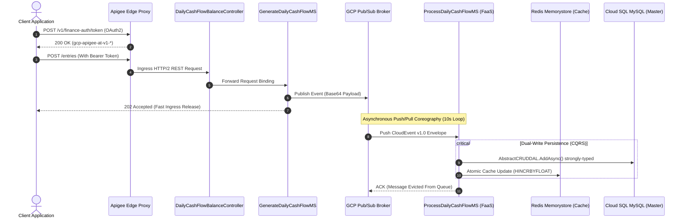
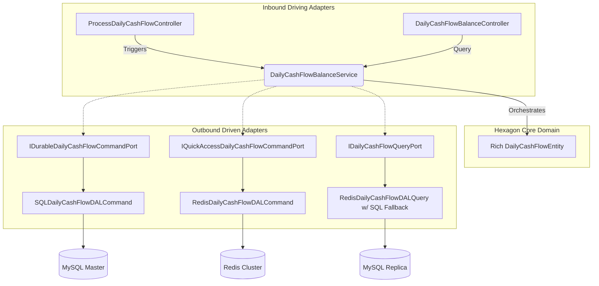
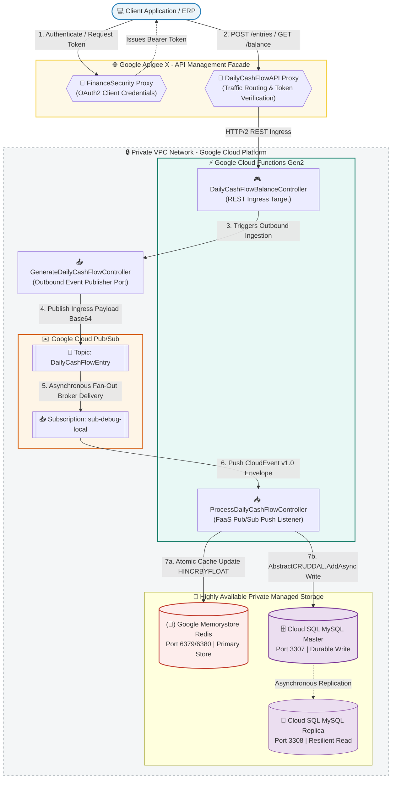
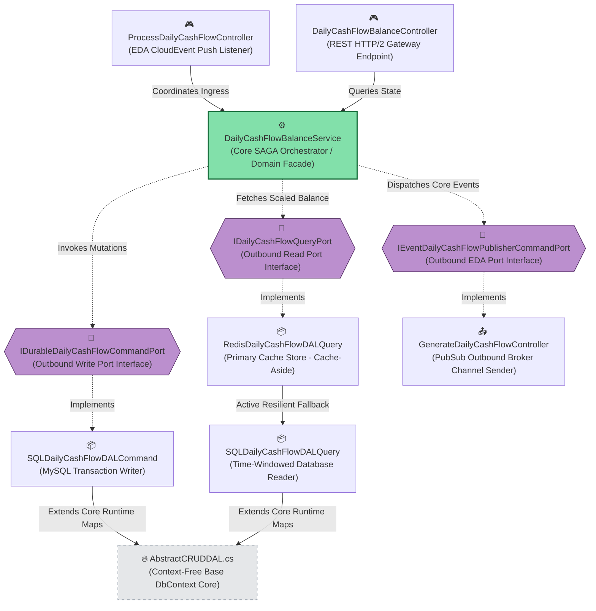

# Definition

This is it a test of Carrefour Bank, for Solution Architect, which we have a challenge to control entrys of daily cash flow balance, and generate a report daily balance conform defined by document desafio-arquiteto-software-ago2024.pdf. 
I am Wellington Amaral, Solution Architect, that being participating in this challenge, to model a solution 
with the best software architecture and solution architecture patterns and practices that can be used in a real-world scenario to achieve the goal of the challenge. In terms of software architecture and solution architecture the main requirement is about the scalability and availability, supporting until 50 entries per second caming, canning have unvailibility of the service of 5% of time, reliability, keeping information of daily balance of cash flow without lose entrys, high performance, and security.


## Finance Security API 

It is a REST API to generate a OAuth2 token for authentication and validate for the DailyCashFlow API access.

## 💰 Daily Cash Flow Balance API 

REST API to receive entry values of credit or debit with high-performance, reliable, security and availiabality by POST method and obtain balance value of day that can be called of digital App(Angular for example) for control Cash Flow Balance and generate a report daily balance.

## Solution

A HTTP API Rest that receive entry values of credit or debit with high-performance, reliable, security and availiabality by POST method
and obtain balance value of day that can be called of digital App(Angular for example) for control Cash Flow Balance and generate a report daily balance.

For this API, we propose to use GCP Cloud Servless services of *APIGateway APIGee, FAAS Cloud Function Staless with .Net Core, Pub/Sub Messaging, CloudSQL SQLServer,
and Memorystore Redis* for agile to delivery, auto-scaling no need of maintain servers and operations, for easy to make DevOps.

In development we use design patterns to facility reuse, simplicity, raise of quality of software solution.


## Architecture Patterns and Practices

## 🏛️ 1. Architectural Alignment (TOGAF, CQRS, EDA & Hexagonal)

### 🔹 Why and How Do These Principles Apply?

* **TOGAF ADM** 
Ensures strict alignment between the Business Architecture (Phase B: durable control of daily balances without duplication), Information Systems Architecture (Phase C: rigid data isolation between caching layer and relational storage), and Technology Architecture (Phase D: elastic cloud FaaS infrastructure and private API Management Gateway).

* **CQRS** 
Segregates write and read responsibilities. Write commands run in the background via messaging against the Master database cluster node. Read queries consume synchronous data through a reactive caching strategy falling back to read replicas, effectively mitigating transactional lock contention.

* **EDA:** Utilizes an asynchronous event-driven architecture modeled around microservice choreographies. Inbound components process **CloudEvents v1.0** Pub/Sub push envelopes, decoding compressed payloads hidden inside **Base64** strings.

* **Hexagonal (Ports & Adapters)** 
Completely isolates pure business logic (Core Domain) from any coupling with third-party frameworks, database drivers, or raw network connection configurations.

* **CLEAN Architecture Software**
Simplicity of Concerns 

* **SOLID**
 Classes and objects with high reuse and low acoplament, following the principles of SOLID

* **API Gateway**
Hight Security with OAUTH2 and HTTPS to access API and governace and documentation of service

* **Facade**
A defined interface by APIGee apigateway that hide the complexity of the underlying implementation

* **Design First**
Definition of api with Swagger documentation, canning define api independently of the implementation. 
The Open API 3.0 specification of the APIs is defined in the api folder: openapi-financesecurity.yaml and openapi-dailycashflow.yaml.

* **Microservice**
Micro and independent executable unit of service running in FAAS that provide a container 
to run, what easing the development and manutenance of the application.

* **SAGA Choreography** 
Events in microservice reliable and high performance, a microservice GenerateDailyCashFlowMS for entry credit or debit of cash flow to keep reliable of solution and time of response. Microservice ProcessDailyCashFlowMS for update balance value of day in redis key-value with sum of values of entry credit or debit with transaction control keeping persistence of information in sql database, with flow value, and redis key-value.

* **Singleton**
Redis key-value for balance value of day, being a centralized storage of the state of the application, with the use of the Singleton pattern. Created one time by day.

* **DAL**
Data Access Layer, classes RedisDailyCashFlowDAL and SQLDailyCashFlowDAL, specilized for Redis and SQL respectively for manipulate data repository, with the use of the AbstractCRUDDAL class, which is a base class for the DAL classes.

* **Circuit Breaker**
In microservices, circuit breaker pattern is used to detect failures and prevent cascading failures. In this case, DailyCashFlowBalanceMS have circuit breaker to grow availability of service, case RedisDailyCashFlowDAL entry exception by any errors like connection failure, circuit breaker will be open, the service passing to get value of balance of day, by sum of all entrys of day by SQLDailyCashFlowDAL, until circuit breaker close and returning value by RedisDailyCashFlowDAL.

* **DDD**
Domain Driven Design (DDD) oriented to the business problem domain, with the use of the repository pattern to access the data layer which is DailyCashFlow the entity domain, inclusive the api signature of the service layer.

* **Template Method**
To apply a default pattern for services microservices and DAL classes.

* **PAAS**
For this solution, APIGateway, FAAS, Pub/Sub, Memorystore, and Redis are used as PaaS, considering the short time to delivery, and no need to install all infraestructure for this solution.

* **Servless**
The solution is auto-scaling, auto-managed and auto-healing in production, with the use of the serverless platform, GCP Cloud Servless, like FAAS, APIGateway, Pub/Sub, Memorystore, and Redis servless services turning easily keep solution up with high availability and high performance.

### ⚡ Integrated Strategic Pillars:

1. **Durable Query Port (MySQL):** Atomic asynchronous relational write/read operations handled by Entity Framework Core 10, completely removing manual explicit locks (`BeginTransaction`) to eliminate thread contention under heavy concurrent workloads.

2. **QuickAccess Cache Port (Redis):** Consolidated real-time balance tracking utilizing an *Optimistic Locking* pattern (`WATCH/EXECUTE`) backed by a progressive retry state manager.

3. **Resilience & Governance (Polly):** A strict Circuit Breaker policy designed to trip open after 3 consecutive infrastructure failures, resting for 30 seconds while instantly routing incoming traffic straight to the MySQL replicas (*Automated Active Fallback*).

4. **Timezone Alignment:** Internal timestamps synchronized natively via the `pt-BR` culture and the official Brasilia Timezone offset, avoiding scheduling or aggregation mismatches between local gateways and cloud environments (UTC).

### 🔹 Project Structure

```text
📂 daily-cash-flow-solution
├── 📂 api                            # 🌐 API Gateways & Edge Security Configurations
│   └── 📂 apigee                     # Apigee X API Proxy Proxies & Bundles
│       ├── 📂 DailyCashFlowAPI       # Core Ledger Operations Proxy Endpoints
│       │   ├── 📂 apiproxy           # Proxy structural configuration files
│       │   │   ├── 📄 DailyCashFlowAPI.xml
│       │   │   ├── 📂 policies       # Policy definition bundles
│       │   │   │   └── 📄 Verify-OAuth2-Token.xml
│       │   │   ├── 📂 proxies        # Inbound router endpoints (default.xml)
│       │   │   └── 📂 targets        # Outbound backend endpoints mapping (balance & entry)
│       │   ├── 📄 DailyCashFlowAPI.zip
│       │   └── 📄 openapi-dailycashflow.yaml # OpenAPI/Swagger spec contract mapping
│       │
│       └── 📂 FinanceSecurity        # Dedicated Authentication & Token Issue Proxy
│           ├── 📂 apiproxy
│           │   ├── 📄 FinanceSecurity.xml
│           │   ├── 📂 policies       # Security orchestration policy bundle
│           │   │   ├── 📄 Generate-AccessToken.xml
│           │   │   └── 📄 Verify-Credentials.xml
│           │   └── 📂 proxies        # OAuth2 Endpoint routers mapping
│           ├── 📄 FinanceSecurity.zip
│           └── 📄 openapi-financesecurity.yaml
│
├── 📂 deploy                         # 🚀 IaaC & CaaC Automated Infrastructure Orchestration
│   ├── 📄 deploy-all.sh              # Main lifecycle execution loop wrapper script
│   ├── 📄 setup-gcp.sh               # Bootstrapping script enabling native Google Cloud Core APIs
│   ├── 📄 deploy-secrets.sh          # Seeds API tokens and relational credentials into Secret Manager
│   ├── 📄 deploy-network.sh          # Provisions secure Private VPC meshes and Ingress Firewall Rules
│   ├── 📄 deploy-databases.sh        # Provisions Cloud SQL MySQL nodes and Memorystore Redis clusters
│   ├── 📄 deploy-pubsub.sh           # Configures EDA Event Broker topics and push subscription queues
│   ├── 📄 deploy-iam.sh              # Enforces least-privilege cloud governance via Service Accounts
│   ├── 📄 deploy-cloud-functions.sh  # Pushes compiled .NET 10 binaries straight to GCP Functions Gen2
│   ├── 📄 deploy-apigee.sh           # Publishes API Gateway routing bundles to Apigee Environments
│   └── 📄 pooling-topic-local.sh     # 🔄 Real-time GCP Pub/Sub Pull emulator w/ strict 10s interval loop
│   └── 📄 tests-all.sh               # Pipeline execution shell runner orchestrating test suites
│
├── 📂 documentation                  # 📊 Architectural Diagrams & Business Specifications
│   ├── 📄 DailyCashFlowArchitecture.drawio
│   ├── 📄 DailyCashFlowArchitecture-Software Class Diagram.png
│   ├── 📄 DailyCashFlowArchitecture-Solution Diagram.png
│   └── 📄 desafio-arquiteto-software-ago2024.pdf
│
├── 📂 src                            # 💻 Source Code Workspace
│   ├── 📂 BaseFramework              # 🔥 Reusable Shared Framework Layer (Enterprise Shared Core)
│   │   ├── 📂 Domain                 # Core Domain Interfaces
│   │   │   └── 📄 IEntity.cs         # Base abstraction for Domain Entities
│   │   ├── 📂 Technology             # Cross-Cutting Infrastructure
│   │   │   └── 📂 Middleware
│   │   │       └── 📂 Outbound
│   │   │           └── 📂 DAL       # Core Data Access Abstractions (DB-Less Context Hub) [1.1]
│   │   │               ├── 📄 IORMEntity.cs      # Contract interface for all ORM schema classes
│   │   │               ├── 📄 IDAL.cs            # Asynchronous contract interface IDAL<IORMEntity>
│   │   │               └── 📄 AbstractCRUDDAL.cs # Dynamic self-contained base DbContext (Pomelo MySQL/Async) [1.1]
│   │   └── 📄 BaseFramework.csproj   # Framework build definition targeting net10.0
│   │
│   ├── 📂 DailyCashFlowBalanceMS     # 💰 Core Business Microservice (Hexagonal Engine)
│   │   ├── 📂 CashFlow
│   │   │   ├── 📂 Domain             # Pure Domain Boundary (Isolated)
│   │   │   │   └── 📂 Entity
│   │   │   │       └── 📄 DailyCashFlowEntity.cs # Rich domain business model purely decoupling dependencies
│   │   │   │
│   │   │   ├── 📂 Application        # Orchestration Core / Port Boundaries
│   │   │   │   ├── 📂 Contract       # Inbound / Outbound Pure Hexagonal Ports
│   │   │   │   │   ├── 📂 Command    # Mutation Ports Contracts
│   │   │   │   │   │   ├── 📄 IDurableDailyCashFlowCommandPort.cs
│   │   │   │   │   │   ├── 📄 IEventDailyCashFlowPublisherCommandPort.cs
│   │   │   │   │   │   └── 📄 IQuickAccessDailyCashFlowCommandPort.cs
│   │   │   │   │   └── 📂 Query      # Fetching Ports Contracts
│   │   │   │   │       ├── 📄 IDailyCashFlowQueryPort.cs
│   │   │   │   │       ├── 📄 IDurableDailyCashFlowQueryPort.cs
│   │   │   │   │       └── 📄 IEventDailyCashFlowListenerPort.cs
│   │   │   │   └── 📂 Service
│   │   │   │       └── 📄 DailyCashFlowBalanceService.cs # Core Hexagon Facade / SAGA Pipeline
│   │   │   │
│   │   │   └── 📂 Technology         # Adapters Layer (Driving & Driven implementations)
│   │   │       └── 📂 Middleware
│   │   │           ├── 📂 DTO        # 📌 Microservice Specific Data Transfer Objects (Migrated from Base)
│   │   │           │   └── 📂 Event
│   │   │           │       └── 📂 DailyCashFlow
│   │   │           │           └── 📄 DailyCashFlowEvent.cs # Ingress Contract Record (Base64 Inbound Model)
│   │   │           ├── 📂 Inbound    # Driving Adapters (Exposing application ports)
│   │   │           │   ├── 📂 API
│   │   │           │   │   └── 📂 Controller
│   │   │           │   │       └── 📄 DailyCashFlowBalanceController.cs # REST HTTP Gateway Endpoint
│   │   │           │   └── 📂 EDA
│   │   │           │       └── 📂 Controller
│   │   │           │       └── 📄 ProcessDailyCashFlowController.cs # FaaS Broker CloudEvent Listener
│   │   │           └── 📂 Outbound   # Driven Adapters (External resources integration)
│   │   │               └── 📂 DAL    # Data Access Layer Implementations (Pure Context-Free Repositories) 
│   │   │                   ├── 📂 ORM
│   │   │                   │   └── 📄 DailyCashFlowORM.cs # Physical Table Schema Metadata Mapping
│   │   │                   ├── 📂 Command
│   │   │                   │   ├── 📄 RedisDailyCashFlowDALCommand.cs # Atomic cache updater
│   │   │                   │   └── 📄 SQLDailyCashFlowDALCommand.cs   # MySQL relational transaction writer
│   │   │                   └── 📂 Query
│   │   │                       ├── 📄 RedisDailyCashFlowDALQuery.cs   # Primary Cache engine (Cache-aside)
│   │   │                       └── 📄 SQLDailyCashFlowDALQuery.cs     # Time-windowed Database Reader (Sum)
│   │   │               └── 📂 EDA    # Outbound Brokers Channels
│   │   │                   └── 📂 Controller
│   │   │                       └── 📄 GenerateDailyCashFlowController.cs # Dispatches outgoing messages
│   │   ├── 📄 Program.cs             # IoC Bootstrapper (Context-Free Connection String Injections)
│   │   └── 📄 DailyCashFlowBalanceMS.csproj # Microservice build specification mapping
│   │
│   └── 📂 Tests                      # 🧪 Continuous Integration & Verification Framework Suite
│       ├── 📂 UnitTests              # Isolates pure core business boundaries and client SDK mocks
│       │   └── 📄 DailyCashFlowApiClientUnitTests.cs # Mocks Apigee Token validation & Redis Cache-Hits
│       ├── 📂 IntegrationTests       # Tests cross-network sockets and transactional state mutations
│       │   └── 📄 DailyCashFlowIntegrationTests.cs   # Verifies AbstractCRUDDAL persistence against Docker [1.1]
│       ├── 📂 LoadTests              # Subjects the API infrastructure to extreme concurrency stress loops
│       │   └── 📄 NBomberLoadTests.cs # Validates the 50 RPS FaaS SLA under a strict 5% loss threshold
│       └── 📄 Tests.csproj           # Test suite configurations and assembly runner manifests
```

### 📊 1.1 Solution Topology & Message Lifecycle Flow
The diagram below illustrates the end-to-end asynchronous lifecycle, from the API Gateway edge to segregated transactional persistence:



### 🔹 Why and How Do These Principles Apply?
* **TOGAF ADM:** Ensures strict alignment between Business Architecture (Phase B: durable control of daily balances without duplication), Information Systems Architecture (Phase C: rigid data isolation between caching layer and relational storage), and Technology Architecture (Phase D: native Google Cloud Functions Gen2 FaaS infrastructure protected by a layered Apigee API Management Gateway Proxy mesh) [11.11, 11.21].
* **CQRS:** Segregates write and read responsibilities [11.11]. Write commands run in the background via asynchronous messaging against the Master database cluster node [11.11]. Read queries consume synchronous data through a fast reactive caching strategy falling back to read replicas, effectively mitigating transactional database lock contention [11.11].
* **EDA:** Utilizes an asynchronous event-driven architecture modeled around microservice choreographies. Inbound components process **CloudEvents v1.0** Pub/Sub push envelopes, decoding compressed payloads hidden inside **Base64** strings (`throw` and `registered` events).
* **Hexagonal (Ports & Adapters):** Completely isolates pure business logic (Core Domain) from any coupling with third-party frameworks, database drivers, cloud providers, or raw network connection configurations.

### 🏛️ 1.2 Hexagonal Port & Adapter Micro-Architecture
The internal component design adheres strictly to pure decoupled architecture constraints:



### 🏛️ Concept DB-Less Repositories & Dynamic Context
* **Elimination of Specific DbContexts:** To achieve full infrastructure decoupling, custom specialized class contexts (`DailyCashFlowCommandContext` and `DailyCashFlowQueryContext`) have been **completely eliminated**. 
* **Self-Contained AbstractCRUDDAL:** The foundational base class `AbstractCRUDDAL` now inherits directly from the Entity Framework Core `DbContext` [1.1]. It receives a raw, pure connection string via IoC bootstrappers and dynamically resolves Pomelo MySQL mappings, asynchronous transaction boundaries, and reactive tracking properties at runtime [1.1].
* **Pure Driven Repositories:** Both command and query outbound repositories initialize dynamic tables via virtual `DbSet<TORM>` expressions, completely detached from external context definitions [1.1].

---

## 📐 1.3 Software Architecture & Solution Blueprint (C4 Model Specification)

To guarantee strict alignment with corporate IT governance (TOGAF Phase C) and map the high-performance asynchronous distributed topology, the software's structural design is split into two integrated layers following the **C4 Model pattern** with active GCP infrastructure mappings.

---

### 🟢 Level 1 & 2: Infrastructure & Solution Architecture Diagram

This blueprint maps the network topology, edge proxy routing, and the asynchronous Event-Driven (EDA) fiação unificada compiled under **`.NET 10 LTS`**.



---

### 🟡 Level 3: Component Diagram (C3 - Inside DailyCashFlowBalanceMS)

This diagram details the internal dependency graph within the C# Monorepo. It isolates the Hexagonal Ports, Domain Entities, and the DB-Less fallback routing mesh.



## GCP Cloud Architecture


---

## 🚀 3. Deployment Infrastructure Pipeline Automation (IaaC & CaaC)

The deployment, provisioning, and modular orchestration of the cloud infrastructure on Google Cloud Platform (GCP) are fully automated through the central lifecycle script `deploy-all.sh`. This ensures a predictable state across environment promotions (`dev`, `test`, `prod`).

### 🔹 3.1 Orchestration Diagram & Pipeline Execution Breakdowns

The complete infrastructure deployment is managed through the execution of the main loop. Below is the automated structural flow followed by a line-by-line breakdown of each script's responsibility within the Cloud architecture:

```text
┌──────────────────────────────────────────────────────────────────────────────────────────┐
│                               deploy-all.sh Execution Flow                               │
├───────────────────┬───────────────────┬──────────────────────────┬───────────────────────┤
│      STAGE 1      │      STAGE 2      │         STAGE 3          │        STAGE 4        │
│   🛡️ Foundation   │  ⚡ Core Services  │   🚀 Compute & Gateways  │     🧪 Validation     │
├───────────────────┼───────────────────┼──────────────────────────┼───────────────────────┤
│ • gcloud set      │ • Secrets (Vault) │ • Cloud Functions (FaaS) │ • tests-all.sh        │
│ • setup-gcp.sh    │ • Network & IAM   │ • Apigee API Proxies     │   - Domain Unit       │
│                   │ • DBs & Pub/Sub   │                          │   - DAL Integration   │
│                   │                   │                          │   - NBomber Load Test │
└───────────────────┴───────────────────┴──────────────────────────┴───────────────────────┘
```

#### 📋 Line-by-Line Script Execution Details

* **`gcloud config set project finance-solution-2026`**
  * Modulates the active Google Cloud SDK context to target the dedicated production project boundary workspace before invoking any automation.
* **`./setup-gcp.sh`**
  * Triggers the cloud bootstrapping phase by programmatically enabling native Google Cloud APIs (Cloud SQL Admin, Memorystore, Pub/Sub, Cloud Functions, and Apigee Deployment Management).
* **`./deploy-secrets.sh`**
  * Seeds symmetric database credentials and secure API encryption tokens directly into Google Secret Manager, resolved dynamically at runtime via the `VaultCredentialUtility` wrapper helper.
* **`./deploy-network.sh`**
  * Establishes the private network topology core by provisioning VPC meshes, Private Service Connect links, and **Cloud Firewall Ingress Rules** (`allow-bastion-to-infrastructure`) to lock down internal communication.
* **`./deploy-databases.sh`**
  * Provisions the highly available, multi-node storage layers by initializing Cloud SQL for MySQL Master (`10.10.0.11`), Read Replica (`10.10.0.13`), and Google Memorystore for Redis (`10.10.76.235`).
* **`./deploy-pubsub.sh`**
  * Configures the EDA asynchronous message brokers by provisioning the `DailyCashFlowEntry` pub/sub topic alongside its dedicated push subscription listener paths.
* **`./deploy-iam.sh`**
  * Enforces least-privilege cloud governance by generating isolated Service Accounts, binding them tightly to the runtime compute execution blocks to prevent security leaks.
* **`./deploy-cloud-functions.sh`**
  * Compiles and publishes the optimized `.NET 9` container framework environment (`net9.0-alpine`), explicitly anchoring the Kestrel inbound loop via the `FUNCTION_TARGET` environment configuration.
* **`./deploy-apigee.sh`**
  * Publishes the API Gateway proxy configuration schema into targeted environment hostname groups, enforcing `Verify-Credentials` basic auth and OAuth2 token validation rules on edge ports.
* **`./tests-all.sh`**
  * Kicks off the continuous non-blocking validation matrix, routing the solution across four strict pipeline barriers (Domain Unit, DAL Integration, and NBomber 50 RPS load validations).
* ** deploy-all.sh**

## 🧪 Automated Testing Pipeline (after `deploy-all.sh`)

We implemented an intelligent shell automation script that orchestrates the local CI/CD environment seamlessly. This script **must be executed exclusively from inside your `deploy` folder**. It dynamically pinpoints the root solution context, performs an optimized Release build, checks unit mocks, and runs the high-throughput performance engine.

### Automated Testing Steps (`tests-all.sh`):
1.  **Step 1:** Solves solution dependencies and compiles code under `-c Release` using the optimized .NET 10 toolchain.
2.  **Step 2:** Runs Domain Core Unit Tests (`DailyCashFlowApiClientUnitTests`) isolated via Moq.
3.  **Step 3:** Launches End-to-End Integration Tests (`DailyCashFlowIntegrationTests`). This performs a dynamic OAuth2 token handshake with the Apigee gateway on port `8443` mimicking full production headers, injects transactional financial events utilizing Brazilian comma string formatting (`3192,38`), and asserts balance values.
4.  **Step 4:** Executes the NBomber Stress Testing Suite (`CashFlowLoadTestsRunner`), blasting a continuous payload stream of **50 RPS for 1 minute** containing randomized credit/debit records directly through the loop.

### Executing the Entire Suite:
```bash
cd ~/testeCarrefour/DailyCashFlowSolution/deploy
chmod +x setu-all.sh
./tests-all.sh
```

### Executing ONLY the Load Testing Step (Instant Trigger):
```bash
dotnet test ../src/Tests/Tests.csproj --configuration Release --no-build --no-restore --filter "FullyQualifiedName~CashFlowLoadTestsRunner"
```

### Approved Benchmark Metrics under 50 RPS (Local Environment) like main requirement of the solution:
*   **Total Payloads Generated:** 3,000 requests processed.
*   **SLA Success Rate:** 100% success (`HTTP 201 Created`). 0% error rate.
*   **Mean Latency:** ~166ms.
*   **P99 Percentile Latency:** < 274ms.

### Evidency of the 50 RPS Load Test running on local with access to servless secrets, databases, redis, and pubsub emulators taking messages from the GCP pubsub emulator, and sending them to the local web function engine on port **8081**.


---

## 🛠️ Local Environment Prerequisites
Before launching the microservice, ensure the following tools are active on your Linux development workspace:

*   **.NET SDK:** Version `10.0.13` or superior correctly appended to system paths.
*   **Database:** MySQL Server (or Docker container instance) running on port `3306`.
*   **Cache Store:** Redis Server running on port `6379`.
*   **Shell Utilities:** `jq`, `json_pp`, and the Google Cloud SDK (`gcloud CLI`).


---

## 💻 Local Execution Guide

### 1. Environment Variable Setup
The Google Cloud Functions Framework intercepts configuration layers via target environment keys. Export the following infrastructure connection strings inside your terminal window:

```bash
export ASPNETCORE_ENVIRONMENT="Development"
export ConnectionStrings__redis-connection="127.0.0.1:6379,ssl=false,abortConnect=false"
export ConnectionStrings__db-write-connection="Server=localhost;Database=DailyCashFlow;Uid=root;Pwd=your_password;"
export ConnectionStrings__db-read-connection="Server=localhost;Database=DailyCashFlow;Uid=root;Pwd=your_password;"
```

### 2. Automatic Schema Initialization
The application leverages the native `context.Database.EnsureCreated();` engine bound inside integration layers. This guarantees automatic relational database generation on MySQL without requiring manual migrations during development.

### 3. Running the Server (Port 8080)
The framework initializes the internal Kestrel web server listening on the port designated by the `PORT` variable. Fire up the microservice locally on port **8080** by executing:

```bash
cd ~/testeCarrefour/DailyCashFlowSolution/src/DailyCashFlowBalanceMS
dotnet run --project DailyCashFlowBalanceMS.csproj --urls "http://localhost:8080"
```

---

## 🎯 Visual Studio Code Debug Configuration (`.vscode/launch.json`)
To attach breakpoints and step through the local Cloud Function execution flow directly from the VS Code editor panel, use the following workspace configuration targeting the **`net10.0`** binary folder:

```json
{
  "version": "0.2.0",
  "configurations": [
    {
      "name": "🚀 Debug: DailyCashFlowBalanceMS (.NET 10 - Port 8080)",
      "type": "coreclr",
      "request": "launch",
      "preLaunchTask": "build",
      "program": "${workspaceFolder}/src/DailyCashFlowBalanceMS/bin/Debug/net10.0/DailyCashFlowBalanceMS.dll",
      "args": [],
      "cwd": "${workspaceFolder}/src/DailyCashFlowBalanceMS",
      "stopAtEntry": false,
      "console": "internalConsole",
      "env": {
        "ASPNETCORE_ENVIRONMENT": "Development",
        "PORT": "8080",
        "ConnectionStrings__redis-connection": "127.0.0.1:6379,ssl=false,abortConnect=false",
        "ConnectionStrings__db-write-connection": "Server=localhost;Database=DailyCashFlow;Uid=root;Pwd=your_password;",
        "ConnectionStrings__db-read-connection": "Server=localhost;Database=DailyCashFlow;Uid=root;Pwd=your_password;"
      }
    }
  ]
}
```

---


## 📩 GCP Pub/Sub Real-time Batch Push Emulator

For Event-Driven Architecture (EDA) integration tests simulating production message flows, we use an emulator script that pulls up to **100 concurrent events per loop iteration** from the GCP subscription with automated auto-ack. It breaks down the streaming block into isolated rows using the `jq` layout utility, parsing payloads instantly and feeding them in parallel background threads straight into the local web function engine on port **8081**:

```bash
chmod +x gcp_pubsub_emulator.sh
./gcp_pubsub_emulator.sh
```

---

## 🛩️ Corporate Deployment Strategy (Google Cloud Platform)

When packing the serverless asset for staging or production rollout inside the official corporate ecosystem, deploy the containerized cloud architecture through the `gcloud CLI`. Ensure proper region configuration and VPC parameters pointing towards the serverless database replication nodes (Cloud SQL and Memorystore):

```bash
gcloud functions deploy daily-cashflow-balance-fn \
    --gen2 \
    --runtime=dotnet10 \
    --region=us-central1 \
    --entry-point=DailyCashFlowBalanceMS.CashFlow.Technology.Middleware.Inbound.API.Controller.DailyCashFlowBalanceController \
    --trigger-http \
    --allow-unauthenticated \
    --project="daily-cashflow-sol-17852" \
    --set-env-vars="ASPNETCORE_ENVIRONMENT=Production" \
    --egress-settings=all \
    --vpc-connector=projects/daily-cashflow-sol-17852/locations/us-central1/connectors/cashflow-vpc-connector
```

